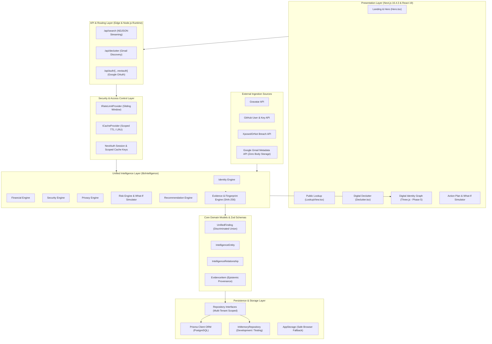

# Architecture Overview — Email-LookUp Digital Identity & Cyber-Defense Platform

## 1. Executive Summary

Email-LookUp is evolving from a point-in-time email scanning tool into a comprehensive **Personal Digital Identity & Cyber-Defense Platform**. The platform provides users with full visibility and control over their digital footprint across four functional pillars:

1. **Identity Intelligence**: Discover public profiles, cryptographic keys, developer identities, and exposed avatar metadata.
2. **Financial Intelligence**: Detect recurring subscriptions, SaaS spend, trial expirations, and financial account linkages.
3. **Security Intelligence**: Correlate multi-source data breaches, credential leaks, authentication risks, and suspicious OAuth grants.
4. **Privacy Management**: Map data brokers, track spam and tracking networks, generate statutory erasure requests (GDPR Art 17, CCPA § 1798, DPDP 2023 § 12(3)), and automate digital declutter.

---

## 2. System Architecture Diagram

---

## 3. Core Architectural Layers

### 3.1 Presentation Layer
- **Framework**: Next.js 16.4.3 (App Router with Turbopack, React 19.3.0, Tailwind CSS).
- **NDJSON Streaming Consumer**: Real-time stream processing for public lookup through `consumeNdjsonStream`, eliminating UI buffer starvation.
- **Client Storage Layer**: `AppStorage` with SSR safe-fallback to manage local preferences without exposing sensitive identity tokens.
- **Graph Projection**: Entity and Relationship models provide built-in `projectEntityToGraphNode()` and `projectRelationshipToGraphEdge()` projections to supply nodes, links, and force-directed simulation parameters to Three.js in Phase 5.

### 3.2 Security & Rate Limiting
- **Partitioned Rate Limiting**: Sliding window rate limiter enforcing discrete limits on public lookup vs. authenticated declutter.
- **Tenant-Scoped Caching**: Strict cache keys (`sec:user:<userId>:<key>` for authenticated users, `sec:public:<key>` for unauthenticated queries) preventing cross-tenant information disclosure.
- **Fail-Closed Secrets**: `lib/config.ts` validates production environment variables, rejecting default fallbacks at server runtime while facilitating isolated CI builds.

### 3.3 Unified Intelligence Layer
The unified intelligence layer normalizes data across heterogeneous sources into standardized epistemic entities:
- **Zero Raw Mailbox Storage**: Only subject lines, sender domains, timestamps, and cryptographic fingerprints are extracted. Raw message bodies are never written to disk or database.
- **Epistemic Honesty Engine**: Explicitly segregates `CONFIRMED_FACT`, `VERIFIED_USER`, `HIGH_INFERENCE`, `LOW_INFERENCE`, and `UNVERIFIED`.
- **Deduplicated Evidence**: Each piece of evidence is indexed by a SHA-256 fingerprint generated from canonical provenance data.
- **Explainable Risk Scoring**: Additive risk scoring with transparent factor attribution (breach exposure, credential risk, high-cost subscriptions, active scopes) and What-If simulation.

### 3.4 Persistence Architecture
- **Schema**: PostgreSQL managed via Prisma (`prisma/schema.prisma`).
- **Isolation**: Tenant isolation enforced at both the repository layer and database constraints (`@@unique([userId, ...])`).
- **Data Retention**: Cascade deletion ensures that when a user invokes their Right to Erasure, all related findings, entities, relationships, and evidence records are completely purged.
