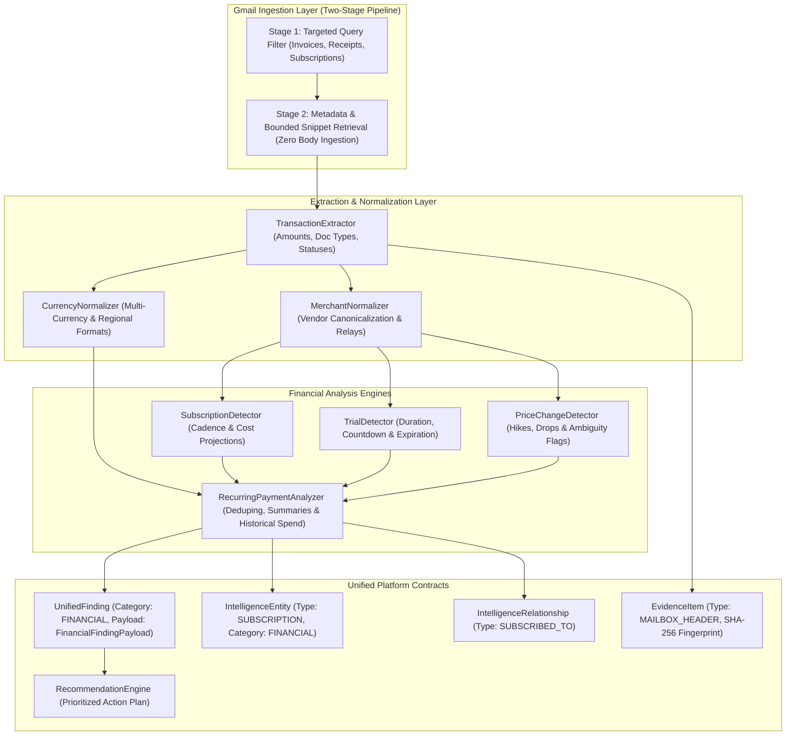

# Financial Intelligence Engine & Subscription Radar — System Documentation

## 1. Executive Summary & Vision

The **Financial Intelligence Engine & Subscription Radar** extends the Email-LookUp cyber-defense platform with automated financial footprint discovery. By auditing message headers and receipt metadata in the user's Gmail mailbox, the engine detects active SaaS subscriptions, recurring streaming commitments, free trial expiration countdowns, and historical price increases.

The module operates under strict zero-raw-message-body storage constraints and adheres to epistemic honesty principles, ensuring that estimates are transparently distinguished from confirmed transactions.

---

## 2. Financial Architecture & Component Topology



---

## 3. Two-Stage Gmail Scanning Strategy

To preserve user privacy and conserve Google API quotas, the engine employs a two-stage scanning pipeline:

### Stage 1: Candidate Discovery
- **Targeted Query**:
  ```text
  subject:(invoice OR receipt OR subscription OR "free trial" OR "renew" OR "membership" OR "billed" OR "payment received" OR "order confirmation" OR "plan renewed")
  ```
- Executes `messages.list` bounded to the latest 100 candidate messages.
- Does not download message bodies or attachments.

### Stage 2: Metadata & In-Memory Extraction
- Bounded batch retrieval using `format=metadata&metadataHeaders=From&metadataHeaders=Subject&metadataHeaders=Date&metadataHeaders=List-Unsubscribe`.
- Gmail API automatically returns the plain text `snippet` field (the first ~150 characters of clean message text), eliminating any need to download full HTML bodies, load external tracking pixels, or execute script tags.
- Credit card numbers (`4111 2222 3333 4444`) and CVV numbers are sanitized and redacted in memory prior to evidence hashing.

---

## 4. Multi-Currency Normalization & Regional Formats

The platform handles global financial patterns without assuming a single default currency:

### Supported Currencies:
- **INR (₹)**: Indian Rupees (handles Lakh/Crore grouping e.g. `₹ 1,49,999.00`).
- **USD ($)**: US Dollars (standard `1,299.50` format).
- **EUR (€)**: Euros (handles European comma decimals e.g. `49,90 €` or `1.250,00 €`).
- **GBP (£)**: British Pounds.
- **JPY (¥)**: Japanese Yen (zero decimal places).
- **CAD (C$), AUD (A$), SGD (S$)**: Disambiguated from generic `$` symbols.

### Conversion & Presentation Isolation:
- **Pristine Transactions**: Raw transaction amounts and currencies are preserved exactly as reported by the merchant.
- **Normalized Aggregations**: The dashboard allows users to toggle between USD ($) and INR (₹) as the primary base currency for high-level recurring totals, calculated using documented baseline conversion rates.

---

## 5. Subscription Cadence & Pattern Recognition

### Cadence Deductions:
1. **Explicit Tags**: Subject/snippet keywords (`/mo`, `monthly`, `/yr`, `annually`, `quarterly`).
2. **Interval Analysis**: For multiple transactions from the same merchant:
   - 25 to 35 days: `MONTHLY`
   - 80 to 100 days: `QUARTERLY`
   - 340 to 390 days: `ANNUAL`
   - 6 to 8 days: `WEEKLY`

### Deduplication Architecture:
If both an invoice and a payment receipt exist for the same transaction event (matching vendor, amount, currency, and date), `RecurringPaymentAnalyzer.deduplicateTransactions()` merges them, giving preference to `CONFIRMED_PAID` status to prevent double-counting.

---

## 6. Free Trial Monitor & Expiration Countdown

The **Free Trial Radar** (`TrialDetector`) identifies trial confirmations and cancellation notices:
- **Duration Parsing**: Extracts explicit day or month intervals (e.g., `14-day free trial`, `1 month free trial`) or parses explicit expiration dates.
- **Status Lifecycle**:
  - `ACTIVE`: Trial ongoing with > 3 days remaining.
  - `EXPIRING_SOON`: $\le 3$ days remaining (triggers immediate alert).
  - `EXPIRED`: Countdown elapsed.
  - `CANCELLED`: Confirmed trial cancellation notice found in mailbox.
- **No Inventions**: If an exact expiration date cannot be determined deterministically, it is flagged as `LOW_INFERENCE` without inventing arbitrary dates.

---

## 7. Price-Change & Rate Increase Detection

The `PriceChangeDetector` compares chronological transactions for the same merchant, currency, and billing frequency:
- **Rate Increases**: Flags adjustments where $\text{newAmount} > \text{previousAmount}$.
- **Ambiguity Guard**: Prevents confusing a plan switch (e.g., switching from $12/month to a $120/year annual plan) with a 900% price hike. If cadence changes or the jump is $\approx 10\times\text{--}14\times$, the event is flagged as `isAmbiguous: true` with a detailed explanatory note.

---

## 8. Epistemic Confidence Classification

| Verification Status | Definition in Financial Context | Example |
| :--- | :--- | :--- |
| **`CONFIRMED_FACT`** | Multiple chronological paid receipts or explicit user verification. | 3 consecutive monthly receipts of $15.49 from Netflix. |
| **`HIGH_INFERENCE`** | Single payment receipt from a known subscription merchant. | Single receipt of $20.00 from OpenAI for ChatGPT Plus. |
| **`LOW_INFERENCE`** | Order confirmation or invoice from an e-commerce or mixed merchant. | Order confirmation for $49.00 from Amazon retail. |
| **`UNVERIFIED`** | Promotional email mentioning pricing without proof of transaction. | Marketing email: "Upgrade to Pro for $19/mo". |

---

## 9. Data Retention & Privacy Principles

1. **Zero Raw Mailbox Body Retention**: Neither the application database nor browser storage ever persists raw email message bodies.
2. **Sanitized Evidence Fingerprinting**: Evidence items store only SHA-256 hashes generated from canonical transaction strings (`merchant:domain:amount:currency:date:invoice`).
3. **Tenant Scoping**: All financial findings and subscription records are strictly partitioned by `userId`.
4. **No Financial Guarantees**: Recommendations provide informational guidance and cancellation links; the platform never executes automated financial cancellations without user authorization.

---

## 10. Known Limitations & Future Work

1. **Multi-Item Retail Invoices**: Complex shopping carts with mixed items (e.g. Amazon orders containing books and household goods) are classified as general orders rather than subscriptions unless clear membership keywords (e.g. "Prime") are present.
2. **Third-Party Payment Gateways**: Invoices billed through generic payment processors (e.g. PayPal, Stripe, Razorpay) rely on display names and subject lines for merchant identification.
3. **Database Migration**: Current persistence is handled by the multi-tenant `InMemoryRepository`. When PostgreSQL is provisioned, the existing `prisma/schema.prisma` will support persistent storage by generating the Prisma client.
