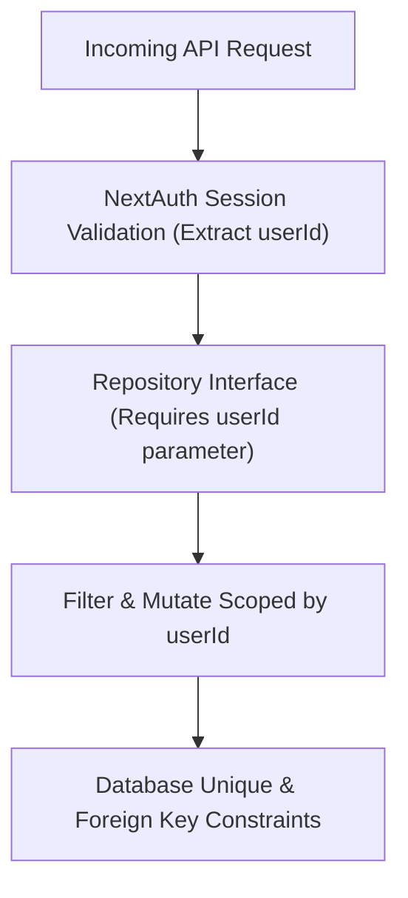

# Persistence Architecture & Database Specification

## 1. Overview

The platform uses a relational persistence architecture with **PostgreSQL** as the primary storage engine, abstracted via **Prisma ORM** (`prisma/schema.prisma`) and accessed through repository interfaces (`lib/intelligence/repositories/`).

This design guarantees:
1. **Strict Multi-Tenant Isolation**: No query or mutation can cross user boundaries.
2. **Referential Integrity**: Cascading deletes guarantee complete erasure on demand.
3. **Zero Raw Mailbox Body Storage**: Strict schema enforcement prevents email body storage.
4. **Environment Agnostic Repositories**: Supports both production PostgreSQL and isolated In-Memory instances for CI/CD and testing.

---

## 2. Prisma Database Schema (`prisma/schema.prisma`)

```prisma
datasource db {
  provider = "postgresql"
  url      = env("DATABASE_URL")
}

generator client {
  provider = "prisma-client-js"
}
```

### 2.1 Core Relational Entities

#### `User`
Primary tenant record.
- Links to NextAuth accounts and sessions.
- Cascades deletion to all findings, entities, evidence, and preferences.

#### `Finding`
Stores actionable intelligence discoveries.
- Foreign key: `userId` (indexed).
- Fields: `category`, `subcategory`, `title`, `description`, `source`, `confidence`, `severity`, `verificationStatus`, `payload` (JSONB).
- Composite indexes: `[userId, category]`, `[userId, severity]`, `[userId, observedAt]`.

#### `Entity`
Stores digital footprint nodes (emails, profiles, domains, breaches).
- Foreign key: `userId` (indexed).
- Fields: `type`, `canonicalValue`, `displayName`, `confidence`, `riskScore`, `metadata` (JSONB).
- Unique constraint: `@@unique([userId, type, canonicalValue])` to enforce deduplication per tenant.

#### `Relationship`
Stores directed graph edges between entities.
- Foreign keys: `userId`, `sourceEntityId`, `targetEntityId`.
- Fields: `type`, `confidence`, `verificationStatus`, `metadata` (JSONB).
- Unique constraint: `@@unique([userId, sourceEntityId, targetEntityId, type])`.

#### `Evidence`
Stores supporting provenance records.
- Foreign keys: `userId`, `findingId` (nullable).
- Fields: `sourceIdentifier`, `evidenceType`, `observedAt`, `reliability`, `fingerprint` (SHA-256), `redactedSnippet`, `metadata` (JSONB).
- Unique constraint: `@@unique([userId, fingerprint])` ensuring automatic cryptographic deduplication.

#### `ScanHistory` & `UserPreference`
- `ScanHistory`: Audit log of scan executions, elapsed times, items discovered, and status.
- `UserPreference`: User-level toggles (e.g. notifications, dark mode, statutory defaults).

---

## 3. Multi-Tenant Isolation Architecture

Data isolation is enforced at three distinct layers:



1. **Authentication Layer**: NextAuth validates the JWT/session and injects a verified `userId`. Unauthenticated requests to private endpoints are rejected with `401 Unauthorized`.
2. **Repository Abstraction Layer**: Every repository method explicitly requires `userId` as its first parameter:
   - `findByUserId(userId: string, filter?: FindingFilter): Promise<UnifiedFinding[]>`
   - `save(finding: UnifiedFinding): Promise<void>` (validates `finding.userId === contextUserId`)
   - `delete(userId: string, id: string): Promise<boolean>` (verifies ownership before delete)
3. **Database Constraints Layer**:
   - PostgreSQL unique constraints (`@@unique([userId, ...])`) physically prevent entity or relationship collisions across users.
   - Cascading deletions (`onDelete: Cascade`) guarantee that `DELETE FROM "User" WHERE id = ?` removes all associated findings, entities, relationships, evidence, and preferences in a single atomic transaction.

---

## 4. Repository Pattern (`lib/intelligence/repositories/`)

The application decouples business logic from the underlying storage mechanism using four core interfaces:

1. **`IFindingRepository`**: CRUD operations, filtering by category, severity, and verification status.
2. **`IEntityRepository`**: Node discovery, querying by type, canonical value deduplication.
3. **`IRelationshipRepository`**: Edge creation, graph neighborhood queries, relationship traversal.
4. **`IEvidenceRepository`**: Cryptographic fingerprint lookup, batch insertion, finding linkage.

### Implementation Implementations:
- **`InMemoryFindingRepository`** (and siblings): Thread-safe in-memory collections utilizing Map and Set data structures with strict `userId` tenant scoping, utilized in unit tests and development environments without database infrastructure.
- **`PrismaFindingRepository`**: Production implementation executing type-safe queries against PostgreSQL.

---

## 5. Data Retention & Privacy Compliance

| Data Category | Retention Policy | Storage Format | Justification |
| :--- | :--- | :--- | :--- |
| **Email Message Bodies** | **NEVER STORED** | Not captured | Strict privacy policy; zero mailbox exposure |
| **Email Headers** | Ephemeral / Redacted | Redacted snippet & SHA-256 hash | Proves existence of subscription without leaking content |
| **OAuth Access Tokens** | Ephemeral | Encrypted session / memory | Never written to persistent database tables |
| **OAuth Refresh Tokens** | Encrypted | AES-256-GCM in Auth Store | Required for offline declutter scanning |
| **Findings & Graph** | Retained until user erasure | Relational PostgreSQL | Powers dashboard and Three.js graph |
| **User Erasure Request** | Immediate purge (< 1s) | Cascading DELETE | Full compliance with GDPR Art 17 & DPDP 2023 § 12(3) |
