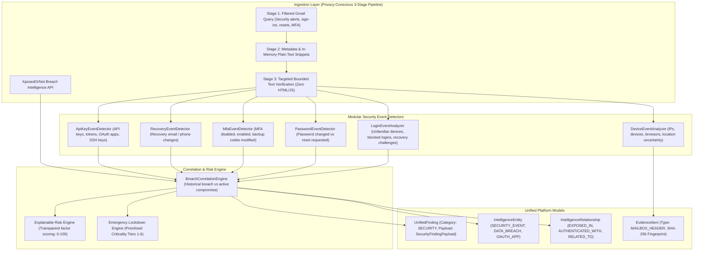

# Security Intelligence & Breach Correlation — System Documentation

## 1. Executive Summary & Vision

The **Security Intelligence & Breach Correlation Engine** equips the Email-LookUp platform with continuous digital threat monitoring and proactive breach response. By correlating multi-source breach disclosures (via XposedOrNot) with security notifications received in the user's Gmail mailbox, the engine provides an interactive security timeline, explainable risk scoring, and a guided emergency lockdown sequence.

The system is designed with strict epistemic integrity: historical data breaches are never conflated with active compromises, and IP-derived geolocation is transparently labeled as an unverified approximation.

---

## 2. Security Intelligence Architecture & Topology



---

## 3. Privacy-Conscious 3-Stage Gmail Retrieval

To protect user confidentiality and prevent quota exhaustion, mailbox inspection follows a bounded 3-stage protocol:

### Stage 1: Targeted Query Filter
- Executes `messages.list` bounded to the latest 80 security candidate emails using targeted boolean queries:
  ```text
  subject:("security alert" OR "new sign-in" OR "new login" OR "unrecognized device" OR "password changed" OR "password reset" OR "two-factor" OR "2fa" OR "verification code" OR "recovery email" OR "api key" OR "access token" OR "suspicious activity" OR "suspended" OR "unusual activity")
  ```

### Stage 2: Metadata & In-Memory Plain Text Snippets
- Ingests headers (`From`, `Subject`, `Date`) and the Gmail API native `snippet` field via `format=metadata`.
- Never executes email HTML or JavaScript.
- Never downloads remote tracking images or web beacons.

### Stage 3: Targeted Bounded Text Verification
- If an unfamiliar device or suspicious sign-in alert snippet truncates critical IP or device metadata, the engine selectively retrieves only the `text/plain` part for that specific message (bounded to a strict maximum of 15 messages).
- All message contents are parsed in volatile memory and immediately discarded. Raw message bodies are **never persisted** to disk or database.

---

## 4. Epistemic Classification of Security Events

The system enforces clear boundaries between attempted events, completed events, and blocked actions:

| Category | Event Type | Action Status | Severity | Epistemic Rationale |
| :--- | :--- | :--- | :--- | :--- |
| **Authentication** | `SUSPICIOUS_ACTIVITY` | `BLOCKED` | `HIGH` | Provider blocked unauthorized sign-in attempt. |
| **Authentication** | `UNFAMILIAR_DEVICE_LOGIN` | `COMPLETED` | `HIGH` | Account was accessed from a previously unseen client/region. |
| **Authentication** | `FAILED_LOGIN_WARNING` | `BLOCKED` | `MEDIUM` | Multiple invalid credentials submitted. |
| **Authentication** | `NEW_LOGIN_DETECTED` | `COMPLETED` | `LOW` | Routine successful login notification. |
| **Credentials** | `PASSWORD_CHANGED` | `COMPLETED` | `HIGH` | Password rotated. Critical if unexpected. |
| **Credentials** | `PASSWORD_RESET` | `ATTEMPTED` | `MEDIUM` | Reset link or OTP issued. |
| **MFA** | `MFA_DISABLED` | `COMPLETED` | `CRITICAL` | Two-factor protection removed. Extreme account risk. |
| **MFA** | `MFA_MODIFIED` | `COMPLETED` | `HIGH` | Backup codes or new auth method added. |
| **MFA** | `MFA_ENABLED` | `COMPLETED` | `INFO` | Security posture upgraded. |
| **Developer** | `API_KEY_CREATED` | `COMPLETED` | `HIGH` | New programmatic token created with API privileges. |
| **Developer** | `OAUTH_APP_AUTHORIZED` | `COMPLETED` | `MEDIUM` | Third-party service granted delegated data access. |
| **Developer** | `SSH_KEY_ADDED` | `COMPLETED` | `HIGH` | Public SSH key added to developer account. |

---

## 5. Breach Correlation & Mitigation Tracking

The `BreachCorrelationEngine` correlates external disclosures with mailbox signals while upholding epistemic boundaries:

1. **Historical Exposure vs. Active Compromise**:
   - A historical data breach that occurred years ago (e.g., Adobe 2013, LinkedIn 2012) does **not** indicate current active compromise.
   - Active compromise is only flagged if recent suspicious activity or unfamiliar logins occurred on that domain.
2. **User-Confirmed Remediation**:
   - The user can explicitly confirm credential rotation for any breach ("Mark as Remediated").
   - Confirming remediation drops the score contribution to 0 and tags the finding as `VERIFIED_USER`.
3. **No Automatic Mitigation Assumptions**:
   - The engine never assumes a breach is mitigated simply because a later routine login alert occurred.

---

## 6. Emergency Lockdown Mode

When suspected credential compromise is detected, the **Emergency Lockdown Workflow** guides the user through an account recovery sequence prioritized by operational blast radius:

```text
Tier 1: Primary Identity & Email (Google Workspace, Gmail, Proton, Outlook)
    ↓
Tier 2: Financial Conduits & Payment Gateways (Stripe, PayPal, Banks)
    ↓
Tier 3: Cloud Storage & Document Vaults (Google Drive, iCloud, Dropbox)
    ↓
Tier 4: Developer Infrastructure & Repositories (GitHub, AWS, Vercel)
    ↓
Tier 5: Social & Communication Platforms (Meta, Twitter/X, LinkedIn)
    ↓
Tier 6: Connected Secondary Accounts & SaaS Tools
```

For each tier, the interface provides:
- Direct link to official account security settings.
- Interactive 4-step checklist:
  1. Password Rotated
  2. MFA Re-verified
  3. Active Sessions Terminated
  4. Connected OAuth Apps Reviewed
- Real-time lockdown readiness indicator.

---

## 7. Device, IP & Geolocation Uncertainty Safeguards

- **IP Parsing**: Public IPv4 addresses are extracted while strictly filtering out loopbacks (`127.0.0.1`), zero-addresses (`0.0.0.0`), and private subnets (`10.x.x.x`, `192.168.x.x`).
- **Location Disclaimer**: Geolocation mentions (e.g., "Near London, UK", "Bengaluru, India") are parsed from provider headers and explicitly tagged with `isLocationEstimated: true`. Geolocation based on IP routing is an approximation and must never be represented as verified GPS location.

---

## 8. Persistence Status

- **Relational Schema**: Security models (`Finding`, `Entity`, `Relationship`, `Evidence`) are codified in `prisma/schema.prisma`.
- **Active Adapter**: In-memory repository implementation (`lib/intelligence/repositories/inMemoryRepository.ts`) scoped strictly by `userId`.
- **Database Status**: PostgreSQL is not yet provisioned in this environment. When provisioned, security events and remediation confirmations will persist seamlessly via Prisma.
